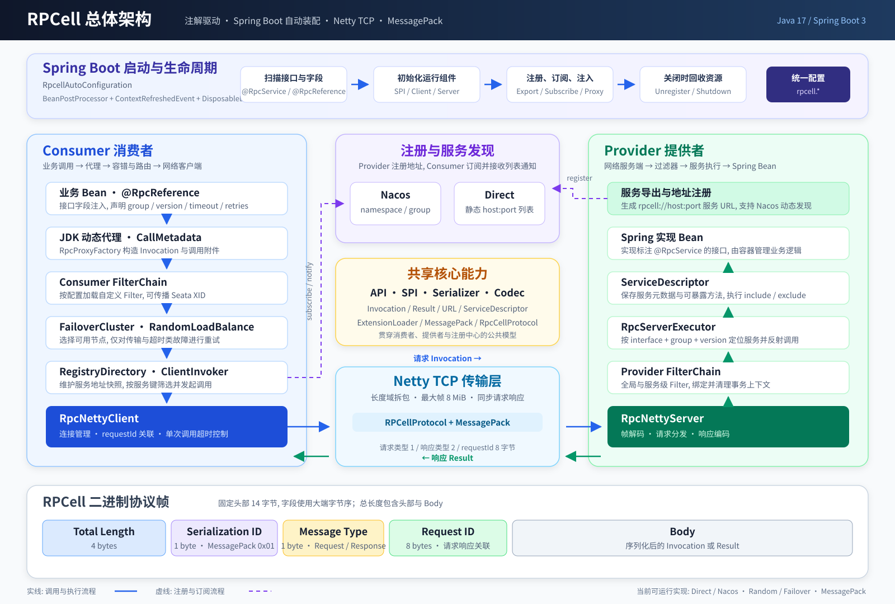

# RPCell

RPCell 是一个基于 **Java 17、Spring Boot 3、Netty 与 MessagePack** 的轻量级 RPC 框架. 它通过注解完成服务导出与引用, 提供服务注册发现、动态代理、集群容错、负载均衡、过滤器、序列化安全控制以及 Spring Boot 自动装配能力. 

当前版本为 `1.0.0`. 本文以仓库中的实际代码为准, 并区分**已接通能力**与**预留/占位能力**, 避免将注解或配置模型中的保留属性误认为已落地功能. 详细架构、调用链和实现约束见 [RPCell 设计文档](RPCell-Design.md). 

## 目录

- [核心特性](#核心特性)
- [总体架构](#总体架构)
- [模块划分](#模块划分)
- [核心工作流程](#核心工作流程)
- [通信协议](#通信协议)
- [快速开始](#快速开始)
- [配置说明](#配置说明)
- [SPI 与 Filter 扩展](#spi-与-filter-扩展)
- [Seata 事务上下文传播](#seata-事务上下文传播)
- [可靠性、异常与安全](#可靠性异常与安全)
- [构建与测试](#构建与测试)
- [当前实现边界](#当前实现边界)
- [关键源码导航](#关键源码导航)

## 核心特性

- **注解式 RPC**: 在接口上声明 `@RpcService`, 在消费者字段上声明 `@RpcReference`, 无需手写客户端和服务端通信代码. 
- **Spring Boot 自动装配**: 自动扫描服务接口与引用字段, 完成 Netty 客户端/服务端、注册中心、服务导出、代理注入和资源销毁. 
- **Netty TCP 通信**: 自定义长度域协议处理粘包/拆包, 通过 `requestId` 关联请求与响应. 
- **MessagePack 序列化**: 基于 Jackson MessagePack, 支持反序列化类型白名单与 JDK 类型开关. 
- **注册与发现**: 支持 Nacos 动态注册发现和 Direct 静态地址直连；消费者可接收 Nacos 服务列表变更通知. 
- **集群容错**: 内置 `FailoverCluster` 与 `RandomLoadBalance`, 支持调用级超时、重试次数、服务分组和版本路由. 
- **可扩展调用链**: 消费者与提供者均支持 Filter(名称自动补齐 `filter:` 前缀)；扩展通过 `ExtensionLoader.register()` 名称注册、`ExtensionLoader.load()` 无参构造加载. 
- **Seata 集成**: 同一 `SeataFilter` 类双向工作——Consumer 侧传播 XID/BranchType, Provider 侧绑定到 `RootContext` 并在 finally 中清理. 
- **服务方法控制**: 支持 `@RpcService(include/exclude)` 与 `@RpcMethod(exposed = false)` 控制方法是否暴露；匹配按名称且支持 `*` 通配. 
- **服务实例隔离**: 默认复用 Spring Bean, 也可通过 `@RpcService(multiInstance = true)` 为指定 RPC 接口创建并缓存独立实例(仍经过依赖注入和初始化回调). 

## 总体架构



架构分为五条主线: 

1. **Spring Boot 生命周期**: `RpcellAutoConfiguration`(实现 `BeanPostProcessor`、`ApplicationListener<ContextRefreshedEvent>`、`DisposableBean`)负责 Bean 扫描、SPI 预热、Netty 启动、注册中心初始化、服务导出、代理注入和资源销毁. 
2. **消费者调用链**: 业务 Bean → JDK 动态代理(`RpcInvocationHandler`)→ Consumer FilterChain → `FailoverCluster`(含 `RandomLoadBalance`)→ `RegistryDirectory`(volatile 地址快照)→ `ClientInvoker` → Netty Client. 
3. **提供者执行链**: Netty Server(业务线程池)→ Provider FilterChain → `RpcServerExecutor`(按 `interfaceClass + group + version` 查找)→ `ServiceDescriptor` → Spring 实现 Bean. 
4. **注册发现链**: Provider 注册服务 URL 到 Nacos/Direct；Consumer 订阅服务并维护每个 `@RpcReference` 独立的 `RegistryDirectory` 地址快照. 
5. **共享基础层**: API 模型(`Invocation`/`Result`/`URL`/`ServiceDescriptor`)、SPI(`ExtensionLoader`)、序列化(`SerializerManager`)和协议编解码(`RpcCellProtocol`)贯穿整个调用过程. 

### 分层职责

| 分层 | 主要职责 | 代表模块/类 |
| --- | --- | --- |
| 接入层 | 注解、配置绑定、Bean 扫描、生命周期编排 | `rpcell-boot`、`RpcellAutoConfiguration` |
| 消费代理层 | 将 Java 方法调用转换为 `Invocation`, 处理返回值或异常 | `rpcell-proxy`、`RpcProxyFactory` |
| 治理层 | 服务地址筛选、节点选择、故障转移、调用过滤 | `rpcell-registry`、`rpcell-cluster`、`rpcell-filter` |
| 协议序列化层 | 请求/响应编解码、MessagePack 序列化、类型校验 | `rpcell-codec`、`rpcell-serializer*` |
| 网络传输层 | TCP 连接、Netty 帧处理、请求响应关联、超时等待 | `rpcell-transport` |
| 服务执行层 | 服务注册表、方法可见性检查、反射调用、结果封装 | `rpcell-server` |
| 扩展集成层 | 名称化 SPI、Seata 上下文传播 | `rpcell-spi`、`rpcell-filter-seata` |

## 模块划分

根工程是 Maven 多模块聚合项目, 共包含 16 个子模块. 

| 模块 | 说明 | 当前状态 |
| --- | --- | --- |
| `rpcell-api` | 注解、常量、枚举、异常、调用/结果/URL 等模型, 以及 SPI 接口 | 已提供公共契约 |
| `rpcell-common` | 公共构建逻辑, 主要是 `ServiceDescriptorBuilder` | 已使用 |
| `rpcell-spi` | `ExtensionLoader` 名称注册、实例创建与单例缓存 | 已使用 |
| `rpcell-serializer` | 序列化器配置、工厂契约与 `SerializerManager` | 已使用 |
| `rpcell-serializer-msgpack` | Jackson MessagePack 实现, 序列化 ID 为 `0x01` | 默认且当前唯一可用实现 |
| `rpcell-registry` | 注册中心抽象、`DirectRegistry`、`RegistryDirectory` | Direct 与服务目录已使用 |
| `rpcell-registry-nacos` | Nacos 注册、注销、订阅、退订与服务列表通知 | 已使用 |
| `rpcell-proxy` | JDK 动态代理与 `CallMetadata` 调用元数据 | 已使用 |
| `rpcell-codec` | `RpcCellProtocol` 请求/响应帧编解码 | 已使用 |
| `rpcell-transport` | `RpcNettyClient`、`RpcNettyServer`、`ClientInvoker` | 已使用 |
| `rpcell-server` | `RpcServerExecutor` 服务查找、方法校验与业务调用 | 已使用 |
| `rpcell-cluster` | `FailoverCluster` 与 `RandomLoadBalance` | 已使用 |
| `rpcell-boot` | Spring Boot 配置属性、自动装配与完整启动/关闭流程 | 业务接入入口 |
| `rpcell-filter` | `FilterChain` 与 `FilterLoader` | 已使用 |
| `rpcell-filter-seata` | Seata XID 与 BranchType 传播过滤器 | 可选集成, 需显式注册和配置 |
| `rpcell-tests` | 聚合单元测试与 Netty 集成测试 | 测试模块 |

## 核心工作流程

### 1. 应用启动

`RpcellAutoConfiguration` 同时实现 `BeanPostProcessor`、`ApplicationListener<ContextRefreshedEvent>` 和 `DisposableBean`, 启动过程如下: 

1. **Bean 初始化后扫描**: 
   - 检查 Bean 实现的接口是否标注 `@RpcService`, 构建 `ServiceDescriptor` 并暂存待导出服务. 
   - 检查字段是否标注 `@RpcReference`, 记录接口、分组、版本、超时、重试和 Filter 等引用元数据. 
2. **Spring Context 刷新完成后启动 RPCell**: 
   - 校验应用名、端口、重试次数、序列化类型和注册中心类型. 
   - 注册内置 MessagePack 与 Random 负载均衡 SPI, 初始化序列化器. 
   - 创建并启动 Netty Client、Netty Server 与 `RpcServerExecutor`. 
   - 创建 Direct 或 Nacos 注册中心. 
   - 注册 Provider 服务并导出服务 URL. 
   - 为每个 `@RpcReference` 创建独立服务目录、集群调用器和 Filter 链, 注入 JDK 代理并订阅服务. 
3. **应用关闭**: 退订服务、注销已注册 URL、销毁注册中心, 并关闭 Netty Server 与 Client. 

> **重要**: 当前 `initServer()` 始终创建 Netty Server 与 Netty Client, 即使 `rpcell.provider.export=false` 或应用只作为 Consumer. 多个启用 RPCell 的进程部署在同一主机时, **必须**配置不同的 `rpcell.transport.port`, 否则端口冲突会导致启动失败. 

### 2. 一次同步 RPC 请求

```text
业务方法调用
  → JDK Proxy / RpcInvocationHandler
  → CallMetadata.toAttachments() 写入 group/version/timeout/retries/loadbalance 等
  → applyMethodAnnotation() 用 @RpcMethod 覆盖 timeout/retries/loadbalance
  → 构造 Invocation(interfaceName=接口全限定名, methodName, parameterTypes, arguments, attachments)
  → Consumer FilterChain(前置正序、后置逆序)
  → FailoverCluster
      → RegistryDirectory.list(invocation) 按 group/version 筛选 URL 快照
      → RandomLoadBalance.select() 从剩余候选中选择一个
      → ClientInvoker.invoke() → RpcNettyClient.send()
          → AtomicLong requestId → CompletableFuture 等待(timeout 附件 → read-timeout 默认值)
  → RpcCellProtocol.encodeRequest() → MessagePack 序列化
  → Netty TCP 传输 14 字节帧头 + Body
  → RpcNettyServer(业务线程池解码)
  → Provider FilterChain
  → RpcServerExecutor.execute()
      → findService(invocation) 按 interfaceClass + group + version 匹配
      → 方法名暴露检查 + getMethod(name, paramTypes) 精确查找
      → 反射 method.invoke(instance, args)
  → Result 封装返回值(success)或 RpcResultException(failure, 含 errorCode/message/exceptionClassName)
  → 原路编码、传输、解码
  → Consumer CompletableFuture 完成 → 代理解包: 异常 → RpcRemoteException；Map → 可选类型转换
```

Provider 使用 `serviceName:group:version` 形成服务键；`serviceName` 默认为接口全限定名, 也可通过 `@RpcService.value()` 设置别名. 请求中的 `interfaceName` 仍使用接口全限定名, Provider 查找服务后再按请求携带的 group/version 匹配. Consumer 的服务目录也会按调用元数据筛选地址, 因此同一接口可以通过 group/version 隔离或并行发布多个版本. 

### 3. 配置优先级

消费者引用的主要配置按以下顺序合并: 

| 属性类别 | 优先级(高→低) |
| --- | --- |
| timeout/retries/loadbalance | `@RpcMethod` 方法注解(在 `applyMethodAnnotation()` 中直接覆盖 Invocation 附件) → `@RpcReference` 字段注解 → `rpcell.consumer.*` / `rpcell.cluster.*` 全局默认值 |
| group/version | `@RpcReference` 字段注解 → 接口 `@RpcService` → `rpcell.consumer.*` 全局默认值 |
| Consumer Filter | 全局 `rpcell.filter.consumer.names`(在前) → `@RpcReference.filter`(在后)；未配置时使用 `rpcell.consumer.filter` |
| Provider Filter | 全局 `rpcell.filter.provider.names`(在前) → `@RpcService.filter`(在后)；未配置时使用 `rpcell.provider.filter` |

其中, `@RpcMethod` 不承载 group/version, 因此 group/version 不会从方法级注解继承. Provider 服务元数据(timeout/retries/weight 等)来自接口 `@RpcService` 注解, 缺失项由 `rpcell.provider.*` 补充(写入 `ServiceDescriptor`), 但部分属性当前仅保存元数据不形成运行行为；详细生效矩阵见 [RPCell 设计文档 - 配置生效矩阵](RPCell-Design.md#15-配置生效矩阵). 

## 通信协议

RPCell 当前使用固定头部的二进制帧: 

```text
0                       4   5   6                       14
+------------------------+---+---+----------------------------+----------------+
| Total Length (4 bytes) | S | T | Request ID (8 bytes)     | Body ...       |
+------------------------+---+---+----------------------------+----------------+
```

| 字段 | 长度 | 含义 |
| --- | --- | --- |
| Total Length | 4 字节 | 整帧长度, 包含 14 字节头部和 Body, 大端字节序 |
| Serialization ID | 1 字节 | 序列化器标识；MessagePack 为 `0x01` |
| Message Type | 1 字节 | `1` 表示 Request, `2` 表示 Response |
| Request ID | 8 字节 | 请求与响应关联 ID |
| Body | 可变 | 序列化后的 `Invocation` 或 `Result` |

Netty 使用长度域解决粘包/拆包, 默认最大帧长为 **8 MiB**. 请求 Body 包含接口、方法、参数和调用附件；响应 Body 使用 `Result` 表示正常值或结构化异常. 

## 快速开始

### 1. 环境要求

- JDK 17+
- Maven 3.8+
- 可选: Nacos 2.x；本地调试也可以直接使用 Direct 模式, 无需注册中心

### 2. 安装并引入依赖

当前仓库版本为 `1.0.0`. 先在项目根目录安装到本地 Maven 仓库: 

```bash
mvn clean install
```

业务服务的最小入口依赖为: 

```xml
<dependency>
    <groupId>io.rpcell</groupId>
    <artifactId>rpcell-boot</artifactId>
    <version>1.0.0</version>
</dependency>
```

`rpcell-boot` 会传递引入 API、MessagePack、Netty、注册发现、集群和 Filter 等当前运行所需模块. 

### 3. 定义服务接口

`@RpcService` 必须放在**接口**上, 而不是实现类上. 服务提供者和消费者应共享同一个接口定义. 

```java
package com.example.hello;

import io.rpcell.api.annotation.RpcService;

@RpcService(group = "demo", version = "1.0.0")
public interface HelloService {

    String sayHello(String name);
}
```

### 4. 编写 Provider 实现

实现类由 Spring 管理即可, 自动配置会扫描它实现的 RPC 接口. 

```java
package com.example.hello.provider;

import com.example.hello.HelloService;
import org.springframework.stereotype.Service;

@Service
public class HelloServiceImpl implements HelloService {

    @Override
    public String sayHello(String name) {
        return "Hello, " + name;
    }
}
```

### 5. 注入 Consumer 引用

```java
package com.example.hello.consumer;

import com.example.hello.HelloService;
import io.rpcell.api.annotation.RpcReference;
import org.springframework.stereotype.Component;

@Component
public class HelloConsumer {

    @RpcReference(timeout = 3000, retries = 2)
    private HelloService helloService;

    public String hello(String name) {
        return helloService.sayHello(name);
    }
}
```

示例中的 group/version 从接口注解继承, 无需在 `@RpcReference` 上重复声明. 

### 6. Direct 直连模式

Direct 模式下, `rpcell.registry.address` 表示 **Provider 的 RPC 地址列表**, 不是独立注册中心地址. 多个地址使用英文逗号分隔, 单项采用单个冒号的 `host:port` 格式；当前不支持 IPv6 字面量. 

Provider `application.yml`: 

```yaml
spring:
  application:
    name: hello-provider

rpcell:
  application:
    name: hello-provider
  transport:
    host: 127.0.0.1
    port: 20880
  protocol:
    serialization: msgpack
  registry:
    type: direct
    address: 127.0.0.1:20880
  provider:
    export: true
```

Consumer `application.yml`(注意: Consumer 也必须配置唯一的 `transport.port`, 因为 Netty Server 总是启动): 

```yaml
spring:
  application:
    name: hello-consumer

rpcell:
  application:
    name: hello-consumer
  transport:
    host: 127.0.0.1
    port: 20881  # 必须与 Provider 端口不同
  registry:
    type: direct
    address: 127.0.0.1:20880,127.0.0.1:20882
  provider:
    export: false  # 不导出服务
  consumer:
    check: true
```

`consumer.check: true` 会在代理注入并订阅后检查是否存在可用 Provider；Direct 的地址列表是静态的, 不会在运行期自动感知进程上下线. 

### 7. Nacos 注册发现模式

Provider 与 Consumer 使用相同的 Nacos 命名空间和分组: 

```yaml
spring:
  application:
    name: hello-provider

rpcell:
  application:
    name: hello-provider
  transport:
    # 应配置其他 Consumer 能访问的地址, 不要直接注册 0.0.0.0
    host: 192.168.1.10
    port: 20880
  registry:
    type: nacos
    address: 127.0.0.1:8848
    namespace: public
    group: DEFAULT_GROUP
    username: nacos
    password: nacos
  provider:
    export: true
  consumer:
    check: true
```

Consumer 只需修改应用名、Netty 端口, 并设置 `rpcell.provider.export: false`；注册中心配置保持一致. Nacos 未开启认证时可省略用户名和密码. 

RPCell 也会读取以下 Spring Cloud Nacos 配置键, 且它们优先于对应的 `rpcell.registry.*` 配置: 

- `spring.cloud.nacos.discovery.server-addr`
- `spring.cloud.nacos.discovery.username`
- `spring.cloud.nacos.discovery.password`
- `spring.cloud.nacos.discovery.namespace`
- `spring.cloud.nacos.discovery.group`

`NacosConfig` 也支持环境变量 `NACOS_HOST`、`NACOS_PORT`、`NACOS_USERNAME`、`NACOS_PASSWORD` 作为初始值, 但 `NacosRegistryFactory.create()` 随后会用 `RegistryConfig` 中的非空值覆盖. 在 Boot 路径下, `RegistryConfig` 的 address/username/password 已被 `resolveNacosAddress/Username/Password()` 解析为 Spring Cloud 优先的值, 因此最终只有未被 Spring Cloud 或 `rpcell.registry.*` 覆盖的字段才会保留 Nacos 环境变量的值. 容器部署建议显式使用 `RPCELL_REGISTRY_ADDRESS` 或 Spring Cloud 配置, 不要将 `NACOS_HOST/PORT` 视为最高优先级覆盖项. 

## 配置说明

配置前缀为 `rpcell`, 完整属性模型位于 `RpcellProperties`. 下表列出当前启动和调用链中常用且已接通的配置. 

### 基础与传输

| 配置 | 默认值 | 说明 |
| --- | --- | --- |
| `rpcell.enabled` | `true` | 是否在 Spring Context 刷新后启动 RPCell |
| `rpcell.application.name` | 无 | 应用名；为空时回退到 `spring.application.name`, 最终不能为空 |
| `rpcell.protocol.serialization` | `msgpack` | 默认序列化方式；启动校验当前只接受 `msgpack` |
| `rpcell.transport.host` | `0.0.0.0` | Netty 监听地址, 同时也用于生成注册 URL；注册场景应改为可访问地址 |
| `rpcell.transport.port` | `20880` | Netty 服务端口, 必须处于 1～65535 |
| `rpcell.transport.threads` | `0` | Netty Server worker 与独立业务线程池大小；小于等于 `0` 时使用 `CPU 核数 × 2` |
| `rpcell.transport.connect-timeout` | `3000` | 客户端建立连接超时, 单位毫秒 |
| `rpcell.transport.read-timeout` | `5000` | 每次 Failover 尝试的默认响应等待时间, 单位毫秒；可被调用 timeout 覆盖 |

### 注册发现

| 配置 | 默认值 | 说明 |
| --- | --- | --- |
| `rpcell.registry.type` | `nacos` | 当前只接受 `nacos` 或 `direct` |
| `rpcell.registry.address` | `127.0.0.1:8848` | Nacos 地址, 或 Direct 模式的 Provider 地址列表 |
| `rpcell.registry.namespace` | 无 | Nacos namespace |
| `rpcell.registry.group` | `DEFAULT_GROUP` | Nacos group |
| `rpcell.registry.username` / `password` | 无 | Nacos 可选认证信息 |

### Provider、Consumer 与集群

| 配置 | 默认值 | 说明 |
| --- | --- | --- |
| `rpcell.provider.export` | `true` | 是否扫描并导出 `@RpcService` 服务 |
| `rpcell.provider.group` / `version` | 空 | Provider 全局默认分组和版本 |
| `rpcell.provider.register` | `true` | Provider 默认是否注册服务地址 |
| `rpcell.provider.filter` | 空列表 | Provider 服务默认 Filter 名称列表 |
| `rpcell.consumer.timeout` | `3000` | 单次调用默认超时, 单位毫秒；可被 `@RpcReference` 覆盖 |
| `rpcell.consumer.retries` | `2` | Consumer 默认重试次数, 不含首次调用 |
| `rpcell.consumer.check` | `false` | 注入引用时是否检查可用 Provider |
| `rpcell.consumer.group` / `version` | 空 | Consumer 全局默认分组和版本 |
| `rpcell.consumer.loadbalance` | 空 | Consumer 默认负载均衡名；为空时回退到集群配置 |
| `rpcell.cluster.loadbalance` | `random` | 集群默认负载均衡名；每次调用按名称从 SPI 解析 |
| `rpcell.cluster.retries` | `2` | 集群默认重试次数, 不能小于 0 |
| `rpcell.filter.consumer.names` | 空列表 | 全局 Consumer Filter 名称列表 |
| `rpcell.filter.provider.names` | 空列表 | 全局 Provider Filter 名称列表 |

### 接口级独立服务实例

| 注解属性 | 类型 | 默认值 | 说明 |
| --- | --- | --- | --- |
| `multiInstance` | `boolean` | `false` | 是否为当前 RPC 接口创建并缓存独立的实现实例 |

`multiInstance` 是 `@RpcService` 的接口注解属性, 不是 `rpcell.*` YAML 配置项, 因此可以对同一个实现类暴露的不同接口分别控制. 

默认情况下, 一个 Spring Bean 实现多个 `@RpcService` 接口时, 所有 RPC 服务共享这个 Bean. 需要隔离某个接口的字段状态或资源时, 在该接口上单独开启: 

```java
@RpcService(multiInstance = true)
public interface OrderService {
    String createOrder();
}

@RpcService
public interface PaymentService {
    String pay();
}
```

如果同一个实现类实现这两个接口, `OrderService` 使用由 RPCell 创建并缓存的独立实例, `PaymentService` 仍使用原 Spring Bean；两个接口都需要独立实例时, 分别添加 `multiInstance = true` 即可. 

独立实例仍支持构造器/字段依赖注入、初始化回调和 BeanPostProcessor, 并在 RPCell 关闭时统一执行销毁回调. 该属性表示"指定 RPC 接口一个启动期单例", **不是每次请求创建新对象, 也不是同服务键的本地负载均衡**. 同一 `serviceName + group + version` 的多个实现仍遵循原有的冲突检查与 `@Primary` 选择规则. 实现类必须能由 Spring 独立创建；JDK 动态代理形式的原始 Bean 不支持该模式. 

### 序列化安全

```yaml
rpcell:
  security:
    serialization:
      # 逗号分隔；支持完整类名和包前缀通配符
      whitelist: com.example.hello.dto.*,com.example.common.Result
      allow-jdk: true
```

- `whitelist` 为空时不额外限制业务类型；配置后, 反序列化目标类型必须匹配完整类名或 `包名.*` 规则. 
- `allow-jdk: false` 会拒绝 `java.*` 目标类型；基本类型和数组组件类型按实现规则处理. 
- 白名单不是网络认证或加密机制. 跨不可信网络部署时, 仍需要在网络边界提供访问控制与传输安全. 

## SPI 与 Filter 扩展

### ExtensionLoader 模型

当前 SPI 是轻量的**名称注册 + 无参构造 + 单例缓存**机制: 

```java
ExtensionLoader.register("filter:trace", TraceFilter.class);
TraceFilter filter = ExtensionLoader.load("filter:trace");
```

内置启动阶段会注册: 

- `serializer:msgpack`
- `random`(RandomLoadBalance)

Failover 每次选择节点前会读取调用中的 loadbalance 名称；非默认值通过 `ExtensionLoader` 加载对应 `LoadBalance`. 自定义策略必须在调用前注册, 未知名称会使调用失败. 

Filter 加载时允许配置 `seata` 或 `filter:seata`, 未带前缀的名称会自动补上 `filter:`. 扩展应在 `ContextRefreshedEvent` 触发 RPCell 启动之前完成注册. 

> 当前没有 Dubbo 风格的 `@Adaptive`、Wrapper 或 `@Activate` 语义, 也没有基于 `META-INF/services` 的自动发现流程. 

### Filter 调用链

自定义 Filter 实现 `io.rpcell.api.spi.Filter`, 在 `invoke` 中修改 `Invocation`、执行前置/后置逻辑, 或调用下一个 `Invoker`. 之后通过 `ExtensionLoader` 注册, 并按需配置: 

```yaml
rpcell:
  filter:
    consumer:
      names: trace,metrics
    provider:
      names: trace,auth
```

也可以在 `@RpcReference(filter = ...)` 或 `@RpcService(filter = ...)` 上声明引用级/服务级 Filter. 全局 `rpcell.filter.*.names` 在前, 局部 Filter 在后；局部未配置时分别回退到 `rpcell.consumer.filter` 或 `rpcell.provider.filter`. 列表中的第一个 Filter 最外层, 前置逻辑正序、后置逻辑逆序执行. 名称不去重, 重复配置会重复执行；任一 Filter 加载失败都会快速失败. 

## Seata 事务上下文传播

`rpcell-filter-seata` 提供可选的 `SeataFilter`(单一类双向工作): 

- **Consumer 侧**: 当前线程存在 XID 时, 将 XID(`RootContext.KEY_XID`)和非空 BranchType(`RootContext.KEY_BRANCH_TYPE`)写入 `Invocation` 附件, 供 Provider 加入同一全局事务. 
- **Provider 侧**: 收到 XID 后通过 `RootContext.bind(xid)` 绑定到当前线程, 有 BranchType 时一并绑定；业务调用完成后在 `finally` 中执行 `RootContext.unbind()` 清理, 避免线程上下文污染. 
- 它只负责事务上下文传播与清理；Seata Server、数据源代理和 `@GlobalTransactional` 仍需由业务应用按 Seata 自身要求配置. 

先增加依赖: 

```xml
<dependency>
    <groupId>io.rpcell</groupId>
    <artifactId>rpcell-filter-seata</artifactId>
    <version>1.0.0</version>
</dependency>
```

在 RPCell 启动前注册, 例如在应用 `main` 方法中: 

```java
ExtensionLoader.register("filter:seata", SeataFilter.class);
SpringApplication.run(Application.class, args);
```

然后在 Consumer 和 Provider 两侧启用: 

```yaml
rpcell:
  filter:
    consumer:
      names: filter:seata
    provider:
      names: filter:seata
```

## 可靠性、异常与安全

### 超时与重试

- 每次调用可携带独立 timeout；`@RpcMethod` 优先于 `@RpcReference`, 后者优先于 Consumer 全局默认值. 
- timeout 作用于**每次 Failover 尝试**, 不会中断 Provider 业务方法, 也不是覆盖全部重试的总 deadline. 
- `retries` 表示首次调用之外的额外尝试次数, 实际最大尝试次数还受初始候选列表长度限制. 
- Failover 每轮从剩余节点中重新选择并移除已尝试节点, 不会无限重试同一个地址. 
- 当前仅客户端/服务端超时、传输错误和集群错误等结果码进入重试；Provider 业务异常不按传输故障重试. 
- 即使只重试传输类故障, 也无法完全证明上一次请求未到达 Provider. 非幂等操作仍应在业务层使用请求号、去重或事务机制防止重复执行. 

### 服务可用性

- `check = true` 只检查启动注入时是否存在地址, 不代表后续调用永远可用. 
- Nacos 模式通过订阅通知刷新地址列表；Direct 模式只使用启动配置中的静态列表. 
- 无可用地址时返回集群错误；调用结果最终代理解包为返回值或异常. 

### 边界校验

- 帧头最小长度为 14 字节, 默认最大帧长为 8 MiB. 
- 反序列化支持目标类型白名单和 JDK 类型限制. 
- RPC 方法只调用已暴露的方法, `include/exclude` 与 `@RpcMethod(exposed = false)` 可用于收敛服务表面. 

## 构建与测试

安装全部模块(根 POM 默认设置 `maven.test.skip=true`, 用于加速安装): 

```bash
mvn clean install
```

显式运行完整测试与构建验证: 

```bash
mvn -Dmaven.test.skip=false clean verify
```

只构建测试模块及其依赖并运行测试: 

```bash
mvn -pl rpcell-tests -am -Dmaven.test.skip=false clean test
```

检查 Java 代码格式: 

```bash
mvn spotless:check
```

## 当前实现边界

以下差异对于评估当前版本非常重要: 

| 能力 | 当前实际情况 |
| --- | --- |
| 调用模式 | 主链路为同步阻塞调用(`CompletableFuture.get(timeout)` 等待 Netty 响应)；`async`、`referAsync` 等保留属性未形成完整异步 API |
| 序列化 | 仅 MessagePack(序列化 ID `0x01`)通过 `SerializerManager` 接通；JSON(`0x02`)、Protobuf(`0x03`)、Postcard(`0x04`)只有 `Serializers` 保留常量, 无对应实现模块 |
| 注册中心 | Direct(静态地址列表)与 Nacos 可用；仓库没有 ZooKeeper 实现, `verifyConfiguration()` 也只接受 `nacos`/`direct` |
| 负载均衡 | 内置 `RandomLoadBalance`(SPI 名 `random`)；可通过 loadbalance 附件名称选择其他已注册 SPI 实现, 未知名称导致调用失败 |
| 集群策略 | 内置 `FailoverCluster`；没有 Failfast、Failsafe、Forking、Broadcast 等策略集合, `@RpcReference.cluster` / `rpcell.consumer.cluster` 仅保存元数据 |
| 引用行为 | `lazy`、`injvm`、`sticky`、`mock`、`cache`、`generic` 等写入 `CallMetadata`/附件但未形成对应运行行为；`injvm`/`sticky` 甚至未进入 `CallMetadata` |
| 监控与日志 | `monitor.enabled`、`log.access.*`、`log.level` 配置模型仅保存, 无监控/访问日志落地 |
| 安全 | 已提供 MessagePack 反序列化类型白名单与 JDK 类型开关；无 TLS、RPC 鉴权或加密传输 |
| SPI | 支持 `register(name, class)` + `load(name)` 无参构造单例；不支持 Adaptive、Wrapper、Activate 等 Dubbo 高级语义 |
| 传输配置 | `idle-timeout`、`max-frame-length` 写入 `RpcellProperties` 但未接入 Netty；帧上限固定 `ProtocolConstants.MAX_FRAME_LENGTH`(8 MiB) |
| Provider 治理 | `timeout`/`warmup`/`delay`/`weight`/`actives`/`executes`/`dynamic`/`accesslog` 等写入 `ServiceDescriptor`, 但不形成超时控制、预热、并发限制、访问日志等治理行为 |

此外, `rpcell.transport.idle-timeout`、`rpcell.transport.max-frame-length`、`rpcell.registry.timeout/retry-times/register-consumer`、`rpcell.cluster.retry-interval`、`rpcell.spi.fail-fast` 和 `rpcell.log.*` 等字段当前未接入对应运行行为；实际帧上限固定为 8 MiB. 完整的生效配置与保留配置矩阵见 [RPCell 设计文档](RPCell-Design.md#15-配置生效矩阵). 

保留注解属性和配置字段主要用于模型兼容或后续扩展. 使用时请以"当前实现边界"和实际运行链路为准. 

## 关键源码导航

- 架构与实现约束: [`RPCell-Design.md`](RPCell-Design.md)
- 自动装配与生命周期: [`RpcellAutoConfiguration`](rpcell-boot/src/main/java/io/rpcell/boot/RpcellAutoConfiguration.java)
- 配置属性模型: [`RpcellProperties`](rpcell-boot/src/main/java/io/rpcell/boot/RpcellProperties.java)
- 服务接口注解: [`RpcService`](rpcell-api/src/main/java/io/rpcell/api/annotation/RpcService.java)
- 服务引用注解: [`RpcReference`](rpcell-api/src/main/java/io/rpcell/api/annotation/RpcReference.java)
- 方法级注解: [`RpcMethod`](rpcell-api/src/main/java/io/rpcell/api/annotation/RpcMethod.java)
- 消费者代理: [`RpcProxyFactory`](rpcell-proxy/src/main/java/io/rpcell/proxy/RpcProxyFactory.java)
- 方法暴露规则: [`ServiceFilter`](rpcell-common/src/main/java/io/rpcell/common/ServiceFilter.java)
- 故障转移集群: [`FailoverCluster`](rpcell-cluster/src/main/java/io/rpcell/cluster/FailoverCluster.java)
- 服务地址目录: [`RegistryDirectory`](rpcell-registry/src/main/java/io/rpcell/registry/RegistryDirectory.java)
- 协议编解码: [`RpcCellProtocol`](rpcell-codec/src/main/java/io/rpcell/codec/RpcCellProtocol.java)
- Netty 客户端: [`RpcNettyClient`](rpcell-transport/src/main/java/io/rpcell/transport/RpcNettyClient.java)
- Netty 服务端: [`RpcNettyServer`](rpcell-transport/src/main/java/io/rpcell/transport/RpcNettyServer.java)
- 服务执行器: [`RpcServerExecutor`](rpcell-server/src/main/java/io/rpcell/server/RpcServerExecutor.java)
- SPI 扩展加载器: [`ExtensionLoader`](rpcell-spi/src/main/java/io/rpcell/spi/ExtensionLoader.java)
- Seata 过滤器: [`SeataFilter`](rpcell-filter-seata/src/main/java/io/rpcell/filter/seata/SeataFilter.java)
- Filter 链构建: [`FilterChain`](rpcell-filter/src/main/java/io/rpcell/filter/FilterChain.java)