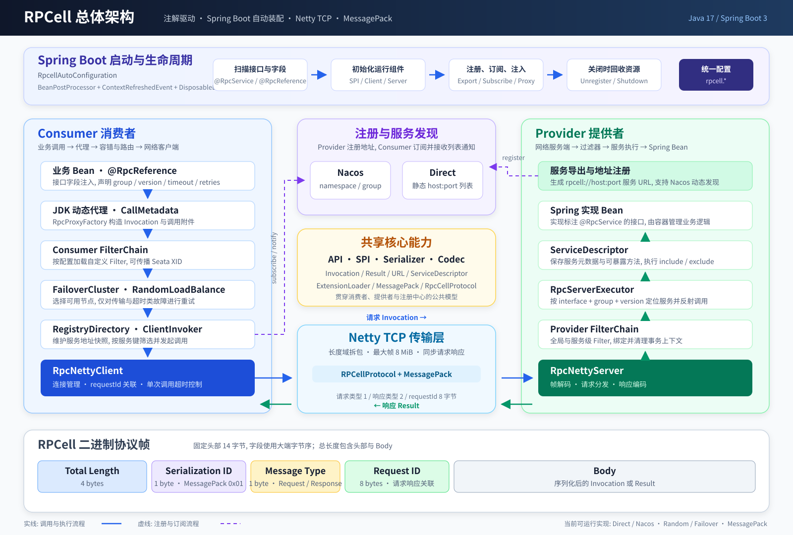

# RPCell 设计文档

> **版本**: 1.0.0  
> **实现基线**: Java 17、Spring Boot 3、Netty、Jackson MessagePack  
> **文档定位**: 描述当前仓库已经实现的功能、运行链路和约束, 不作为未来功能清单. 使用与接入示例见 [README.md](README.md). 

## 目录

1. [设计目标与范围](#1-设计目标与范围)
2. [核心实现约束](#2-核心实现约束)
3. [总体架构](#3-总体架构)
4. [模块划分与依赖](#4-模块划分与依赖)
5. [核心契约](#5-核心契约)
6. [Spring Boot 生命周期](#6-spring-boot-生命周期)
7. [Provider 设计](#7-provider-设计)
8. [Consumer 与配置合并](#8-consumer-与配置合并)
9. [通信协议](#9-通信协议)
10. [传输与并发模型](#10-传输与并发模型)
11. [注册发现](#11-注册发现)
12. [集群容错与负载均衡](#12-集群容错与负载均衡)
13. [序列化与 SPI](#13-序列化与-spi)
14. [Filter、代理与 Seata](#14-filter代理与-seata)
15. [配置生效矩阵](#15-配置生效矩阵)
16. [可靠性、安全与运维边界](#16-可靠性安全与运维边界)
17. [构建、测试与变更验收](#17-构建测试与变更验收)

## 1. 设计目标与范围

RPCell 是一个以同步请求/响应为主的轻量级 RPC 框架, 目标是在保持模块边界清晰的同时, 提供可直接接入 Spring Boot 的最小完整链路: 

- 通过 `@RpcService`、`@RpcReference`、`@RpcMethod` 声明服务契约与调用元数据. 
- 通过 JDK 动态代理、Netty TCP 和 Jackson MessagePack 完成远程调用. 
- 通过 Direct(静态地址列表)或 Nacos 获取 Provider 地址, 通过 RegistryDirectory 隔离服务目录. 
- 通过 FailoverCluster 与 RandomLoadBalance 提供有限、明确的故障转移能力. 
- 通过名称化 SPI、Filter 链和 Seata Filter 提供扩展点与事务上下文传播. 

当前仓库只有 Java 17 实现, 整个主链路为同步阻塞调用. Rust、跨语言 golden 测试、JSON/Protobuf/Postcard 实现、ZooKeeper、异步调用 API、TLS、鉴权、监控和访问日志均不属于当前已落地能力. 常量、注解或配置模型中存在的保留字段, 不代表对应行为已经接通. 

## 2. 核心实现约束

以下约束是当前实现正确性的基础, 修改相关代码时应同时更新回归测试和文档. 

| 编号 | 约束 |
| --- | --- |
| R01 | `@RpcService` 必须声明在接口上；Provider 与 Consumer 共享同一接口契约.  |
| R02 | 注册服务名取 `@RpcService.value()`, 为空时使用接口全限定名；`Invocation.interfaceName` 始终使用接口全限定名, 两者不能混为一谈.  |
| R03 | Provider 服务键为 `serviceName:group:version`；同名服务通过 group/version 隔离.  |
| R04 | 每个 `@RpcReference` 字段使用独立的 `RegistryDirectory` 和 `FailoverCluster`, 禁止跨引用共享可变地址目录.  |
| R05 | `RegistryDirectory` 使用不可变列表和 `volatile` 引用整体替换地址快照；读取侧不得修改快照.  |
| R06 | Direct 通用 URL 不带服务元数据, 可供匹配的订阅服务使用并绕过 group/version 过滤；具体服务 URL 必须按元数据隔离, 禁止回退到其他服务地址.  |
| R07 | 方法暴露按名称集合控制, 实际反射调用必须再按方法名和完整参数类型数组精确匹配, 不能只按名称分派重载方法.  |
| R08 | 同一服务键的候选实现按 `@Primary` 选择；同优先级冲突必须在启动期报错, 不能静默覆盖.  |
| R09 | Netty pending 请求在正常响应、写失败、解码失败、超时、中断、连接关闭和发送异常时及时完成并清理.  |
| R10 | 已取得请求头的服务端错误响应必须携带原始 requestId；只有解析请求头之前的失败才使用 requestId `0`.  |
| R11 | 等待连接被中断时必须取消连接尝试；若连接同时成功则关闭该连接, 并保留原始中断异常、恢复调用线程中断标记.  |
| R12 | Nacos 退订必须使用订阅时保存的同一个 `EventListener`；首次查询或通知失败必须回滚本地映射和远程订阅.  |
| R13 | Nacos 订阅、事件通知与退订需要处理并发；失活订阅的事件必须忽略, 退订失败保留可重试状态.  |
| R14 | SPI 重注册同名扩展时必须清除旧单例缓存；并发加载不得让已失效实例重新进入缓存.  |
| R15 | Filter 加载失败必须快速失败；链上前置逻辑按列表正序执行, 后置逻辑按相反顺序返回.  |
| R16 | Failover 只重试明确可重试的结果码或调用异常, 最大尝试次数受重试配置和初始候选列表长度共同限制, 计数计算不得溢出.  |
| R17 | 注册中心工厂创建实例后必须完成 `init()`；销毁失败后不能重新初始化, 直到重试销毁成功.  |
| R18 | 配置文档必须区分"影响运行行为""仅保存元数据"和"完全未接通", 不能仅因字段存在就宣称功能可用.  |
| R19 | 同一服务键的注册 URL 中 `URL.serviceName` 等于 Nacos 注册的 service name(由 `buildServiceName` 生成), 而 `URL.group` 被写入 Nacos Instance 的 `clusterName`, 两者共同构成服务标识；`rpcell.registry.group`(Nacos group)是独立的命名空间层级, 不可混淆.  |
| R20 | `@RpcMethod` 的 timeout/retries/loadbalance 在代理层 `applyMethodAnnotation()` 中直接写入 `Invocation` 附件, 该调用在 `CallMetadata.toAttachments()` 之后执行, 因此必然覆盖 `@RpcReference` 和 Consumer 默认值；`@RpcMethod` 不承载 group/version 覆盖.  |

## 3. 总体架构



主调用链如下: 

```text
业务调用
  → JDK Proxy / RpcInvocationHandler
  → Consumer FilterChain
  → FailoverCluster
  → RegistryDirectory 地址快照
  → RandomLoadBalance
  → ClientInvoker / RpcNettyClient
  → RpcCellProtocol + MessagePack
  → Netty TCP
  → RpcNettyServer 业务线程池
  → Provider FilterChain
  → RpcServerExecutor
  → ServiceDescriptor / Spring Bean
  → Result 原路返回
```

职责边界: 

- **Boot** 负责扫描、配置合并、对象组装和生命周期, 不承载协议或负载算法. 
- **Proxy** 负责 Java 方法与 `Invocation`/`Result` 的转换, 不直接访问注册中心. 
- **Registry** 负责注册、订阅和地址快照, 不执行远程调用. 
- **Cluster** 负责候选节点选择与故障转移, 不感知 Nacos 客户端. 
- **Codec** 负责帧和消息体编解码；**Transport** 调用协议并管理网络、连接和 pending 请求, 并非纯字节管道. 
- **Server** 负责服务查找、暴露校验、精确方法分派和业务异常封装. 

## 4. 模块划分与依赖

根工程聚合 16 个子模块；包含根 POM 时共 17 个 Reactor 项目. 

| 模块 | 当前职责 |
| --- | --- |
| `rpcell-api` | 注解、SPI 接口、常量、错误码、异常和纯数据模型 |
| `rpcell-common` | `ServiceDescriptorBuilder` 与 `ServiceFilter` |
| `rpcell-spi` | `ExtensionLoader` 名称注册、实例化和缓存 |
| `rpcell-serializer` | `SerializerManager`, 按序列化 ID 管理 Serializer |
| `rpcell-serializer-msgpack` | 当前唯一可用的 MessagePack 实现 |
| `rpcell-registry` | Registry 生命周期、DirectRegistry、RegistryDirectory |
| `rpcell-registry-nacos` | 基于 Nacos NamingService 的注册发现 |
| `rpcell-proxy` | JDK 动态代理和 `CallMetadata` |
| `rpcell-codec` | `RpcCellProtocol` 请求/响应帧编解码 |
| `rpcell-transport` | Netty Client/Server、pending 请求和 ClientInvoker |
| `rpcell-server` | 服务表、服务匹配、方法校验与反射执行 |
| `rpcell-cluster` | FailoverCluster 与 RandomLoadBalance |
| `rpcell-filter` | FilterLoader 与 FilterChain |
| `rpcell-filter-seata` | 可选 Seata 上下文传播 Filter |
| `rpcell-boot` | 配置绑定、自动装配、启动编排和资源销毁 |
| `rpcell-tests` | 跨模块单元测试与本地 Netty 集成测试 |

依赖版本集中在根 POM 的 `dependencyManagement`, 插件版本集中在 `pluginManagement`. 子模块使用 `rpcell-` 前缀平级放置, 具体序列化、注册中心和 Filter 实现按 `rpcell-<维度>-<实现>` 命名. 

## 5. 核心契约

### 5.1 Invocation

| 字段 | 含义 |
| --- | --- |
| `interfaceName` | 被调用接口的全限定名, 用于 Provider 查找服务 |
| `methodName` | 方法名, 用于暴露校验和方法查找 |
| `parameterTypes` | 完整参数类型数组, 用于区分重载 |
| `arguments` | 调用参数 |
| `attachments` | group、version、timeout、retries、目标地址和事务上下文等字符串元数据 |

### 5.2 Result

`Result` 只包含 `value` 或 `RpcResultException`. 异常载体保存错误码、消息和远端异常类名, 不传输完整 Java 堆栈. Consumer 代理将异常载体解包为 `RpcRemoteException`, 不会实例化远端异常类型. 

### 5.3 URL 与 ServiceDescriptor

- `URL` 描述注册地址及其 `serviceName/group/version`. 
- `ServiceDescriptor` 保存接口类型、注册服务名、group/version、暴露方法名集合、实现实例和配置元数据. 
- `toServiceKey()` 使用 `serviceName:group:version`, 空 group/version 在键中表现为空段. 

### 5.4 错误码

| 码值 | 枚举 | 含义 |
| --- | --- | --- |
| 0 | `OK` | 成功 |
| 1001 | `CLIENT_TIMEOUT` | 客户端等待超时 |
| 1002 | `SERVER_TIMEOUT` | 服务端超时分类；Failover 可重试 |
| 2001 | `SERVICE_NOT_FOUND` | 服务不存在或元数据不匹配 |
| 2002 | `METHOD_NOT_EXPOSED` | 方法未暴露 |
| 2003 | `METHOD_NOT_FOUND` | 完整方法签名不存在 |
| 3001 | `PARAMETER_ERROR` | 参数错误 |
| 4001 | `SERIALIZATION_ERROR` | 序列化或反序列化错误 |
| 5001 | `TRANSPORT_ERROR` | 连接、写入、中断或其他传输错误 |
| 6001 | `REGISTRY_ERROR` | 注册中心错误 |
| 7001 | `CLUSTER_ERROR` | 无地址或集群调用失败 |
| 9999 | `UNKNOWN_ERROR` | 未分类服务端错误 |

## 6. Spring Boot 生命周期

### 6.1 扫描阶段

`RpcellAutoConfiguration` 是 BeanPostProcessor, 在 Bean 初始化后执行两类扫描: 

1. 遍历 Bean 实现的全部接口, 发现 `@RpcService` 并构建待注册 `ServiceDescriptor`. 
2. 遍历 Bean 类及父类字段, 发现 `@RpcReference` 并保存接口、字段和调用元数据. 

`rpcell.enabled=false` 会跳过 ContextRefreshedEvent 中的 RPC 启动, 但当前自动配置没有使用 `@ConditionalOnProperty`, 因此不能将其理解为完全不创建自动配置 Bean 或完全不执行扫描. 

### 6.2 启动顺序

Context 刷新完成后, 按以下顺序启动: 

1. 校验应用名、端口、集群重试次数、序列化类型和注册中心类型. 
2. 注册 MessagePack SerializerFactory 与 RandomLoadBalance SPI, 初始化 SerializerManager. 
3. 创建 RpcServerExecutor、RpcNettyClient、ClientInvoker 和 RpcNettyServer. 
4. 构建 Provider Filter 调用链并启动 Netty Server. 
5. 创建并初始化 DirectRegistry 或 NacosRegistry. 
6. 注册 Provider 到本地服务表, 并按配置向注册中心导出 URL. 
7. 为每个引用创建独立 Directory/Cluster、构建 Consumer Filter 链、注入代理、订阅地址并执行可选 check. 

任一步骤失败都会调用销毁流程并重新抛出异常, 避免留下半启动状态. 

即使 `rpcell.provider.export=false` 或应用只有 Consumer, 当前实现仍会在 `initServer()` 中无条件启动 Netty Server 与 Netty Client, 因此同机多个进程(无论 Provider/Consumer 角色)必须配置不同的 `rpcell.transport.port`. 

### 6.3 关闭顺序

关闭时依次退订、注销 URL、销毁注册中心、关闭 Netty Server、关闭 Netty Client, 最后销毁由 RPCell 创建的 multi-instance 服务对象. 退订、注销、Netty 关闭和独立实例销毁分别记录清理异常；注册中心通过 `AbstractRegistry.destroy()` 统一释放资源. 

## 7. Provider 设计

### 7.1 服务名与多实现

- `@RpcService.value()` 是注册别名；为空时使用接口全限定名. 
- 一个实现类实现多个 RPC 接口时, 按接口分别构建服务描述. 
- 同一服务键出现多个候选时, `@Primary` 候选优先；两个 Primary 或两个普通候选冲突时启动失败. 
- `rpcell.provider.export` 与 `@RpcService.export` 必须同时为 true 才导出. 
- `rpcell.provider.register` 与 `@RpcService.register` 必须同时为 true 才向注册中心注册；本地服务导出和远程注册是两个独立步骤. 

### 7.2 multiInstance

默认复用原 Spring Bean. `@RpcService(multiInstance = true)` 时, RPCell 通过 Spring `AutowireCapableBeanFactory.createBean` 为该 RPC 接口创建一个独立实例: 

- 实例在启动期创建并缓存, 不是每次请求创建. 
- 仍经过依赖注入、初始化回调和 BeanPostProcessor, 关闭时执行销毁回调. 
- 同一实现类的其他接口可以继续共享原 Bean. 
- 需要具体实现类, JDK 动态代理形式的原始 Bean 不支持该模式. 

### 7.3 方法暴露与服务分派

暴露规则按以下顺序计算: 

1. 方法存在 `@RpcMethod` 时, 直接采用 `exposed`. 
2. `exclude` 命中则拒绝. 
3. `include` 非空且未命中则拒绝. 
4. 其余方法默认暴露. 

匹配只按方法名, 支持 `*` 通配；同一方法名的重载共享暴露资格. 服务执行时先检查方法名是否暴露, 再使用 `interfaceClass.getMethod(methodName, parameterTypes)` 精确查找, 避免无参或重载方法被错误分派. 

请求中的 group/version 非空时, 服务查找必须精确匹配；未携带时它们不作为过滤条件. 业务方法抛出的异常封装为 `UNKNOWN_ERROR` Result, 由服务端保留原始 requestId 返回. 

## 8. Consumer 与配置合并

### 8.1 引用注入

引用字段类型必须是带 `@RpcService` 的接口, 否则跳过. 每个字段独立完成代理注入和订阅, 调用链共享 Netty Client, 但不共享 Directory 或 Cluster. 

`check = @RpcReference.check || rpcell.consumer.check`. check 为 true 时, 在订阅完成后按当前 group/version 检查地址快照, 空列表导致启动失败；该检查不代表运行期地址持续可用. 

### 8.2 元数据优先级

| 元数据 | 合并规则 |
| --- | --- |
| Consumer group/version | `@RpcReference` → 接口 `@RpcService` → `rpcell.consumer.*` |
| Consumer timeout/retries/loadbalance | `@RpcMethod` 直接覆盖附件(在 `CallMetadata.toAttachments()` 之后) → `@RpcReference` → `rpcell.consumer.*` |
| Consumer loadbalance | `@RpcMethod` → `@RpcReference` → `rpcell.consumer.loadbalance` → `rpcell.cluster.loadbalance`；Failover 按最终名称从 SPI 获取策略 |
| Provider group/version | 接口 `@RpcService` → `rpcell.provider.*` |
| Consumer Filter | 全局 `rpcell.filter.consumer.names` 在前, 引用 Filter 在后；引用未配置时使用 `rpcell.consumer.filter` |
| Provider Filter | 全局 `rpcell.filter.provider.names` 在前, 服务 Filter 在后；服务未配置时使用 `rpcell.provider.filter` |
| Nacos 连接配置 | 非空 `spring.cloud.nacos.discovery.*` → 对应 `rpcell.registry.*` |

应用名优先使用 `rpcell.application.name`, 为空时回退到 `spring.application.name`. 常规配置绑定和外部环境覆盖遵循 Spring Boot 规则. 

`NacosConfig` 另外支持 `NACOS_HOST`、`NACOS_PORT`、`NACOS_USERNAME`、`NACOS_PASSWORD` 作为初始值, NacosRegistryFactory 随后用 RegistryConfig 中的非空值覆盖. Boot 下 Spring Cloud 配置优先于 `rpcell.registry.*`；由于 address 默认非空, `NACOS_HOST/PORT` 只有在最终解析地址为空时才保留, 未配置用户名或密码时对应 NACOS 环境变量可以继续生效. 

## 9. 通信协议

帧结构固定为 14 字节头加消息体, 整数使用大端字节序: 

| 偏移 | 字段 | 长度 | 说明 |
| --- | --- | --- | --- |
| 0 | Total Length | 4 | 整帧长度, 包含头部和 Body |
| 4 | Serialization ID | 1 | MessagePack 为 `0x01` |
| 5 | Message Type | 1 | `1` Request, `2` Response |
| 6 | Request ID | 8 | 请求与响应关联 ID |
| 14 | Body | 可变 | 序列化后的 Invocation 或 Result |

Netty 使用 `LengthFieldBasedFrameDecoder` 处理粘包/拆包, 保留完整帧交给 `RpcCellProtocol`. 帧解码上限是 `ProtocolConstants.MAX_FRAME_LENGTH` 的 **8 MiB**；`rpcell.transport.max-frame-length` 当前未接入. 

协议层检查帧和头部至少为 14 字节, 通过 SerializerManager 按序列化 ID 获取实现. 未知序列化 ID 不会静默回退到 MessagePack. Netty 的长度域负责验证帧边界, 协议解析本身不再次比较声明长度与数组长度, 也不额外拒绝未知消息类型. 

## 10. 传输与并发模型

### 10.1 Client

- 使用 NioEventLoopGroup, 连接按 `host:port` 缓存, 失效后重新连接. 
- requestId 是 Client 实例内的 AtomicLong 递增值, 用于该实例的 pending 映射, 不是跨进程全局唯一 ID. 
- 调用线程在 CompletableFuture 上同步等待, NIO 线程负责读取、解码并完成 Future. 
- `rpcell.transport.connect-timeout` 用于 Netty 建连；`read-timeout` 是单次发送后的默认等待时间. 
- 正整数 `timeout` 附件覆盖默认等待时间；非法或非正值回退到默认值. 
- 每次 Failover 尝试分别等待, 没有覆盖全部重试的全局 deadline. 

pending 请求必须覆盖所有终止路径: 正常响应、写失败、连接/发送异常、响应解码失败、超时、中断和 Channel 关闭. 中断等待时清理 pending、恢复线程标记并返回 `TRANSPORT_ERROR`；中断建连时还需执行 R11 的连接取消与竞态关闭. 

### 10.2 Server

- 使用一个 boss 线程、worker 线程组和独立业务线程池. 
- `rpcell.transport.threads <= 0` 时, worker 与业务线程池均采用 `CPU 核数 × 2`；大于 0 时两者均采用配置值. 
- 业务解码、Filter 和反射调用在业务线程池执行, 避免阻塞 NIO worker. 
- 已取得请求头的处理失败使用原 requestId 和序列化 ID 返回 `UNKNOWN_ERROR`；无法解析请求头时使用 requestId `0`. 

## 11. 注册发现

### 11.1 通用生命周期

`AbstractRegistry` 统一管理初始化、注册、注销、订阅、退订和销毁状态. 注册与订阅前必须初始化；销毁先标记销毁中, 再关闭具体实现资源. 销毁失败后保持不可初始化状态, 直到重试销毁成功. 

### 11.2 DirectRegistry

- `rpcell.registry.address` 是逗号分隔的 Provider `host:port` 列表, 不是独立注册中心地址. 
- 空片段被忽略；host 不能为空, 端口必须为 1～65535, 单个地址只能包含一个冒号, 因此当前不支持 IPv6 字面量. 
- 地址被转换为不带 service/group/version 的通用 URL. 
- 订阅后立即通知一次；首次通知抛异常时回滚订阅. 
- 普通服务订阅只接受同名 URL 或通用 URL, `*` 订阅接受全部地址. 
- Direct 列表是静态配置, 不会自动感知进程上下线. 

### 11.3 NacosRegistry

- 直接使用 Nacos NamingService, 不实现额外连接池或复杂重试. 
- 注册时 `URL.serviceName` 通过 `buildServiceName` 生成 Nacos service name, `URL.group` 写入 Nacos Instance 的 `clusterName`, `URL.version` 写入 instance metadata. `rpcell.registry.group` 是独立的 Nacos group 命名空间, 决定 NamingService 操作的 group 参数, 与前述 URL group/clusterName 是不同维度. 
- 只将 healthy 且 enabled 的实例转换为可用 URL；同时携带 serviceName(来自 Instance.serviceName)、clusterName(映射为 URL.group)和 version 元数据. 
- 订阅时保存原始包装 EventListener(`Subscription`), 先远程 subscribe, 再查询当前全部实例并立即通知 Directory. 
- 首次查询或通知失败时回滚本地映射和远程订阅；失活订阅的后续事件被忽略. 
- 退订使用保存的同一 `EventListener`；失败保留原监听器以便再次退订, 成功后清理空映射. 

当前 `rpcell.registry.register-consumer` 未接入, Consumer 只订阅, 不注册自身实例. 

## 12. 集群容错与负载均衡

Boot 为每个引用传入 `RandomLoadBalance` 作为默认策略, Failover 每轮从剩余候选中选择并移除一项. 选择前会读取 loadbalance 附件: 名称为空, 或名称为 `random` 且默认实现为 `RandomLoadBalance` 时直接使用默认策略(`Extensions.LOADBALANCE_RANDOM`), 绕过 `ExtensionLoader` 查找；其他非空名称通过 `ExtensionLoader.load(name)` 获取对应 LoadBalance. 自定义策略必须在调用前注册, 未知名称会使调用失败. 

重试规则: 

- `retries` 表示首次调用之外的额外尝试次数. 
- 最大尝试次数为 `min(retries + 1, 初始候选列表项数)`, 并使用长整型计算避免整数溢出. 
- 初始列表是快照；重复 URL 不去重, 因此重复项仍可能选中同一地址. 
- `CLIENT_TIMEOUT(1001)`、`SERVER_TIMEOUT(1002)`、`TRANSPORT_ERROR(5001)`、`CLUSTER_ERROR(7001)` 以及调用抛出的 Exception 可进入重试. 
- Provider 返回的业务异常、服务/方法错误和序列化错误不按传输故障重试. 
- 所有尝试失败后返回最后一次失败 Result. 

重试不能证明上一次请求未到达 Provider. 非幂等业务必须使用业务请求号、去重或事务机制防止重复执行. 

## 13. 序列化与 SPI

### 13.1 ExtensionLoader

SPI 是显式的"名称 → Class → 单例"容器: 

- 名称精确匹配, 不做 META-INF/services 自动发现. 
- 重注册同名 Class 会清除旧实例缓存. 
- 加载使用无参构造；同线程循环加载通过 ThreadLocal 栈检测. 
- 并发构造可能产生临时重复对象, 但缓存只保留一个有效实例；重注册不会让旧实例重新进入缓存. 
- 不支持 Adaptive、Wrapper、Activate 等 Dubbo 扩展语义. 

Boot 当前显式注册 `serializer:msgpack` 和 `random`. Filter 名称可以写 `seata` 或 `filter:seata`, 缺少 `filter:` 前缀时由 `FilterLoader.load()` 自动补齐. Provider 和 Consumer 的 Filter 名称列表在 `buildProviderRequestHandler()` 和 `injectReferences()` 中分别通过 `FilterLoader.load()` 解析, 均支持该前缀补齐规则. 

### 13.2 SerializerManager

SerializerManager 按序列化 ID 缓存 Serializer, 并从配置选择默认实现. Boot 初始化当前只接受 `msgpack`；重复 init 不会替换已经初始化的默认 Serializer. 新增实现需要分配稳定 ID、注册 Factory, 并同时调整 Boot 的类型校验和装配逻辑. 

### 13.3 MessagePack

- 基于 Jackson MessagePack, Map 按键排序, 属性名采用 `snake_case`. 
- 顶层 null 序列化为零字节；null 或空字节反序列化为 null, 并跳过目标类型校验. 
- 白名单支持完整类名和 `包名.*`, 为空时不额外限制业务类型. 
- `allow-jdk=false` 时拒绝 `java.*` 目标类型, 白名单不能覆盖该拒绝规则. 
- 数组检查组件类型, 基本类型直接允许. 
- 白名单和 JDK 类型限制只降低反序列化风险, 不等同于网络认证、授权或加密. 

## 14. Filter、代理与 Seata

### 14.1 FilterChain

FilterChain 从列表尾部开始包装目标 Invoker, 因此列表第一个 Filter 最外层: 

```text
Filter[0] 前置
  → Filter[1] 前置
    → 目标 Invoker
  → Filter[1] 后置
→ Filter[0] 后置
```

空列表直接返回目标 Invoker. 名称不去重, 重复配置会重复执行；任一 Filter 加载失败都会终止启动或引用装配. 

### 14.2 JDK 代理

- `equals`、`hashCode`、`toString` 在本地执行, 不发 RPC. 
- Result 异常统一解包为 `RpcRemoteException`. 
- 当返回值为 Map 且目标返回类型不是 Map/void 时, 代理尝试通过默认 Serializer 做二次类型转换；转换失败记录警告并保留原值. 
- `@RpcMethod` 的 timeout/retries/loadbalance 会覆盖引用附件；其余保留属性只写元数据, 不形成额外运行行为. 

### 14.3 SeataFilter

Consumer 当前线程存在 XID 时, 将 XID 和非空 BranchType 写入附件. Provider 收到 XID 后绑定 RootContext, 再执行后续 Invoker, 并在 finally 中清理本次绑定的上下文. 

SeataFilter 只负责传播和清理上下文. Seata Server、数据源代理、`@GlobalTransactional` 及业务事务边界仍由应用自行配置. 

## 15. 配置生效矩阵

### 15.1 已影响运行行为的配置

| 配置 | 默认值 | 当前作用 |
| --- | --- | --- |
| `rpcell.enabled` | `true` | 是否执行 Context 刷新后的 RPC 启动 |
| `rpcell.application.name` | 空 | 应用名, 空时回退 Spring 应用名 |
| `rpcell.protocol.serialization` | `msgpack` | 序列化选择；启动仅接受 msgpack |
| `rpcell.transport.host` | `0.0.0.0` | Server 绑定及 Provider URL 地址 |
| `rpcell.transport.port` | `20880` | Server 端口及 Provider URL 端口 |
| `rpcell.transport.threads` | `0` | Server worker 与业务线程池大小 |
| `rpcell.transport.connect-timeout` | `3000` | Client 建连超时, 毫秒 |
| `rpcell.transport.read-timeout` | `5000` | 单次 RPC 调用默认等待时间(`RpcNettyClient.send()` 的 Future.get 超时), 毫秒；可被 `timeout` 附件覆盖 |
| `rpcell.registry.type` | `nacos` | 仅接受 nacos/direct |
| `rpcell.registry.address` | `127.0.0.1:8848` | Nacos 地址或 Direct Provider 地址列表 |
| `rpcell.registry.username/password` | 空 | Nacos 认证 |
| `rpcell.registry.namespace` | 空 | Nacos namespace |
| `rpcell.registry.group` | `DEFAULT_GROUP` | Nacos group |
| `rpcell.cluster.retries` | `2` | Cluster 默认额外重试次数, 必须不小于 0；通常被 Consumer/注解 retries 覆盖 |
| `rpcell.cluster.loadbalance` | `random` | 最终负载均衡名的集群默认值 |
| `rpcell.consumer.loadbalance` | 空 | Consumer 默认负载均衡名, 空时回退到集群配置 |
| `rpcell.provider.export` | `true` | 是否扫描并导出 Provider |
| `rpcell.provider.group/version` | 空 | Provider 默认路由元数据 |
| `rpcell.provider.register` | `true` | 是否向注册中心注册 Provider URL |
| `rpcell.provider.filter` | 空列表 | 服务级默认 Filter |
| `rpcell.consumer.timeout` | `3000` | Consumer 默认单次等待时间 |
| `rpcell.consumer.retries` | `2` | Consumer 默认额外重试次数 |
| `rpcell.consumer.check` | `false` | 引用注入后是否检查地址 |
| `rpcell.consumer.group/version` | 空 | Consumer 默认路由元数据 |
| `rpcell.consumer.filter` | 空列表 | 引用级默认 Filter |
| `rpcell.filter.provider.names` | 空列表 | 全局 Provider Filter |
| `rpcell.filter.consumer.names` | 空列表 | 全局 Consumer Filter |
| `rpcell.security.serialization.whitelist` | 空 | MessagePack 反序列化白名单 |
| `rpcell.security.serialization.allow-jdk` | `true` | 是否允许 `java.*` 目标类型 |

### 15.2 仅保留或仅写元数据的配置

以下字段存在于配置模型, 但当前不能据此推断对应行为: 

| 配置 | 当前状态 |
| --- | --- |
| `rpcell.protocol.name/version` | 未参与协议选择或帧版本控制 |
| `rpcell.transport.idle-timeout/max-frame-length` | 未接入；帧上限固定为 8 MiB |
| `rpcell.registry.timeout/retry-times/register-consumer` | 未接入 Nacos 操作和消费者注册行为 |
| `rpcell.cluster.retry-interval` | 未接入重试等待 |
| `rpcell.provider.timeout/warmup/delay/weight/actives/executes/dynamic/accesslog/cluster/tag/validation/mock/cache/async/generic` | 仅合并到 ServiceDescriptor；其中 `timeout` 写入描述符但在 Provider 端 `RpcServerExecutor.execute()` 中不参与任何超时控制 |
| `rpcell.consumer.lazy/async/validation/mock/cache/sent/actives/cluster/tag` | 仅保存 CallMetadata 或附件, 未形成对应调用行为 |
| `rpcell.consumer.sticky/injvm` | 仅存在于配置模型, 未进入 CallMetadata, 也无对应运行行为 |
| `rpcell.spi.fail-fast` | 未读取；SPI/Filter 当前按自身实现快速失败 |
| `rpcell.monitor.enabled`、`rpcell.log.*` | 未接入监控、访问日志或日志级别控制 |

注解中的 async、referAsync、injvm、sticky、mock、cache、generic、listener、callbacks 等保留属性同样不构成已实现的异步、本地调用、容错替代或回调能力. 

## 16. 可靠性、安全与运维边界

- 当前是同步阻塞调用, 没有业务侧 CompletableFuture 异步 API. 
- 超时是每次尝试的等待时间, 不是服务端执行中断, 也不是全重试链总 deadline. 
- Direct 是静态地址列表；Nacos 才能通过订阅通知动态刷新地址. 
- `check=true` 只保证注入后的当前快照非空, 不保证后续调用成功. 
- 业务异常保留消息和类名, 不保留远端堆栈；排查时应结合 Provider 日志. 
- 默认 `transport.host=0.0.0.0` 适合监听但不适合作为其他进程访问的注册地址, Nacos 部署应配置可路由地址. 
- RPCell 没有 TLS、RPC 身份认证或授权；不可信网络需要外围安全控制. 
- Nacos 测试主要使用 NamingService 代理/测试替身, Netty 使用本地真实 Socket 集成测试；当前没有 Testcontainers Nacos 或跨语言契约测试. 

## 17. 构建、测试与变更验收

根 POM 默认 `maven.test.skip=true`. 完整验证必须显式打开测试: 

```bash
mvn -Dmaven.test.skip=false clean verify
mvn spotless:check
```

只运行测试模块及其依赖: 

```bash
mvn -pl rpcell-tests -am -Dmaven.test.skip=false clean test
```

修改核心链路时, 至少覆盖以下回归场景: 

1. 多服务、多 group/version 与每引用 Directory 隔离. 
2. 同名重载、无参方法、include/exclude 和 `@RpcMethod`. 
3. 原始 requestId、写失败、长短帧、解码失败、连接关闭、超时与中断. 
4. Direct 首次通知回滚、通用地址过滤、Nacos 监听器一致性和并发退订. 
5. SPI 重注册缓存失效、Filter 顺序与失败快速暴露. 
6. Failover 最大重试边界、不可重试业务异常和重复调用风险说明. 
7. Spring `@Primary`、multiInstance 生命周期、启动失败清理与资源销毁. 

新增或修改能力时, 应同步更新 README 的使用说明、本文的实现约束和生效配置矩阵；规划能力必须明确标记为"未实现", 不能与当前功能混写. 